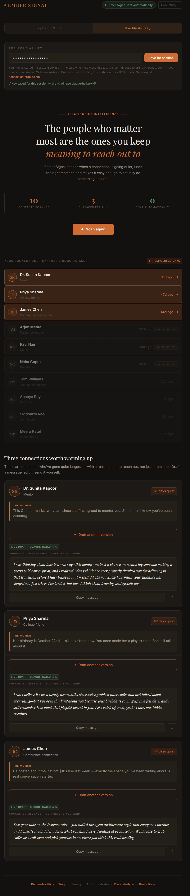

# Ember Signal

**Personal Relationship Intelligence Tool**  
Portfolio project by Rishendra Vikram Singh · rishendra125.github.io

---

## How to Use the Demo

The live demo is at [rishendra125.github.io/ember_signal_project/demo.html](https://rishendra125.github.io/ember_signal_project/demo.html)

**Try Demo Mode (no API key needed)**
1. Open the demo link
2. The header defaults to **Try Demo Mode** — click it if not already selected
3. Click **Scan contacts**
4. Watch the scan animation run across all 10 contacts
5. Three are surfaced — click **Draft a warm message** on any of them
6. A pre-written sample draft appears instantly, tagged *Demo draft*

**Try with your own Anthropic API key**
1. Click **Use My API Key** in the header
2. Paste your key into the field and click **Save for session**
   - The key is stored in `sessionStorage` only — it clears when you close the tab and is never sent anywhere except directly to Anthropic's API
3. Click **Scan contacts**, then **Draft a warm message**
4. A live Claude Haiku response appears, tagged *Live Draft · claude-haiku-4-5*
5. Use the **Draft another version** button to regenerate

You can get an Anthropic API key at [console.anthropic.com](https://console.anthropic.com). Free-tier credits are enough to run the demo.

---

## What It Is

Ember Signal is a personal noticing layer for relationships. Most relationship tools solve logistics (reminders, calendar nudges, CRM follow-ups). Ember Signal solves something harder: noticing when a meaningful connection is quietly drifting, before it is too late to do something natural about it.

Inspired by [Julie Zhuo's essay on AI and social life](https://lg.substack.com/p/what-would-make-ai-truly-social), and [Sonia Baschez's observation](https://x.com/SoniaBaschez/status/2107267198091997211) that "Silicon Valley keeps building me a husband when what I really want is a wife." The logistics layer is solved. The noticing layer is not.

Hero tagline: *"The people who matter most are the ones you keep meaning to reach out to. Ember Signal notices before you forget."*

---

## Live Demo Screenshot



---

## The Problem with Existing Tools

CRM reminders fire on a schedule, not on a moment. LinkedIn nudges are generic. Calendar follow-ups have no warmth. None of them ask: is this actually a good time to reach out? Is there a real reason? Would this message feel natural or forced?

Ember Signal answers those questions before surfacing a contact to you.

---

## Three-Step Architecture

The pipeline is deliberately split between rule-based logic and a single AI call. This is an intentional design choice, not a limitation.

### Step 1 — Threshold Scan (Rule-Based, No AI)

Scans all contacts and flags anyone where `days_since_last_contact > 30`.

- The threshold is transparent and configurable
- No black box, no model inference at this stage
- Every contact either passes or fails a single numeric check

### Step 2 — Context Signal Ranking (Rule-Based, No AI)

Of the flagged contacts, Step 2 filters to those with a context signal attached and sorts by days neglected descending. The top 3 are surfaced.

- A contact flagged by Step 1 but with no signal is skipped (shown as "no moment yet" in the UI)
- This is the key product insight: a nudge without a moment is just noise
- Arjun Mehta (52 days quiet) does not surface because there is no natural hook to reach out right now. Dr. Sunita Kapoor (61 days, mentorship anniversary) does.

### Step 3 — Message Draft (AI — Claude API via sample capability)

The only AI call in the entire product. Triggered manually when the user clicks "Draft a warm message."

Claude receives:
- Contact name and relationship type
- Notes on shared history
- The specific context signal for this moment

Claude returns a 2-sentence warm personal message that references the moment naturally, sounds like something the user would actually send, and contains no template language or AI markers.

The user reads it, edits it if they want, and sends it themselves. Nothing is sent automatically.

---

## Synthetic Dataset

Ten contacts covering varied relationship types, each with a last-contact date and optionally a context signal.

| Name | Relation | Days | Signal |
|---|---|---|---|
| Dr. Sunita Kapoor | Mentor | 61 | Two-year mentorship anniversary this October |
| Priya Sharma | College friend | 47 | Birthday October 22nd, six days away |
| James Chen | Conference connection | 44 | Both watching the Instinct $1B raise |
| Arjun Mehta | Former colleague | 52 | None (skipped by Step 2) |
| Ravi Nair | Cousin | 38 | None (skipped by Step 2) |
| Neha Gupta | Neighbour | 35 | None (skipped by Step 2) |
| Tom Williams | LinkedIn connection | 12 | Recent contact (below threshold) |
| Ananya Roy | Book club | 18 | Recent contact (below threshold) |
| Siddharth Rao | Gym buddy | 8 | Recent contact (below threshold) |
| Meera Patel | School friend | 15 | Recent contact (below threshold) |

Surfaced contacts: Dr. Sunita (61d), Priya (47d), James (44d).  
Skipped despite threshold: Arjun, Ravi, Neha (no signal).  
Below threshold: Tom, Ananya, Siddharth, Meera.

---

## Context Signals

A context signal is a specific, time-relevant reason why reaching out right now would feel natural rather than random. It is stored as a fixed string in the dataset and passed verbatim into the Claude prompt.

Example for Dr. Sunita Kapoor:

> "This October marks two years since she first agreed to mentor you. She doesn't know you've been counting."

Claude uses this signal as material to write around, not a sentence to copy. The output typically paraphrases the signal in warmer language:

> "It's been a little while, and I realised this October marks two years since you first said yes to mentoring me, something I've quietly been keeping track of."

This is the distinction: the signal is deterministic data, the message is AI-generated prose.

---

## System Prompt Design

```
Write a short, warm personal message from me to [name].

Relationship: [relation]
Days since we last spoke: [days]
What I know about them: [notes]
The specific moment or reason: [signal text]

Instructions:
- Write exactly 2 sentences. No more.
- Reference the specific moment naturally, woven in, not stated as a subject.
- Warm and genuine, not gushing. The kind of message someone sends without editing it first.
- Do not open with "Hey", "Hi [name]", or any name-first greeting.
- Do not mention AI or that this was drafted by a tool.
- Write only the message text, nothing else.
```

The hard sentence cap ("exactly 2 sentences, no more") was added after testing showed Claude defaulting to 3-4 sentences when given a range. A firm ceiling produces consistently sendable output.

---

## Visual States During Scan

The scanning animation makes the rule-based logic visible in real time.

| State | Visual | Meaning |
|---|---|---|
| Scanning | Amber border, sweep animation | Step 1 evaluating this contact |
| Flagged | Amber glow, ◆ icon, ember text | Over threshold AND has signal — will surface |
| No signal | Slight dim, faint amber border, "no moment yet" tag | Over threshold but no signal — skipped by Step 2 |
| Quiet | Strongly dimmed, no border | Below threshold — recently in contact |

This transparency is intentional. The user should understand why three specific people surfaced, not feel like a black box made a recommendation.

---

## Trust Design

**"0 messages sent automatically"** is pinned as a persistent badge in the header throughout the entire interface. It never disappears.

This is not a disclaimer. It is a product principle. Ember Signal is a noticing layer and a drafting layer. It deliberately stops before sending. The human is always the one who decides to reach out and how.

---

## Technical Stack

- Plain HTML, CSS, JavaScript — no framework, no build step
- Claude artifact with `sample` capability — real Claude API calls from within the artifact runtime, no API key required, calls route through claude.ai infrastructure
- All data baked into the file — fully self-contained, no backend, no database
- Deployed as a private Claude artifact (Phase 1 demo)

---

## What This Demonstrates

**Human-centred product thinking** — The problem is emotional and relational, not logistical. The solution is built around the human in the loop, not automation for its own sake.

**AI placement discipline** — AI is used for exactly one thing (message drafting) and not for the parts that do not need it (threshold scanning, signal ranking). Steps 1 and 2 are deterministic by design.

**Consumer product lens** — Warm, personal language throughout. No enterprise jargon. Designed for someone managing real relationships, not a sales pipeline.

**Inspiration to spec pipeline** — Started from a viral tweet and a Substack essay, moved to a product insight, then to a working demo with a real API call. End to end, no engineering team required.

---

## Limitations

**Synthetic data only — no real contact integration**  
The demo runs on 10 hardcoded contacts. A real product would need to connect to Gmail, WhatsApp, or a calendar to derive actual last-contact dates. That integration is non-trivial and raises its own privacy questions.

**Privacy and third-party consent**  
Storing relationship notes and contact data about people who never opted in is ethically and legally uncomfortable. A production version would need to be local-first — data stays on the user's device, only the message draft prompt leaves to Claude. Any cloud storage model requires disclosures that most users would find uncomfortably close to surveillance the moment they read them carefully.

**Context signals require curation**  
Right now the signals are hand-written into the dataset. In a real product, detecting a "moment" automatically — a birthday, a mutual interest news event, an anniversary — requires either heavy integration work (calendar, LinkedIn, RSS) or another AI layer to surface signals from raw data. That second AI layer adds cost, latency, and its own accuracy risks.

**Single threshold for all relationship types**  
30 days is the same cutoff for a mentor, a cousin, and a conference connection. In reality the right threshold varies by relationship depth and history. A mentor you saw last week matters more than an acquaintance you last spoke to 20 days ago. The current rule-based Step 1 has no notion of relationship weight.

**No feedback loop**  
The demo does not learn from what the user does after seeing a draft — whether they sent it, ignored it, or edited it heavily. A real product would use that signal to tune thresholds and signal quality over time. Without it, the system never improves.

---

## Author

Rishendra Vikram Singh  
Senior Consultant, SPRAC Services Pvt. Ltd., Noida  
Emerging AI Orchestrator — applying program and delivery management discipline to building AI products  
rishendra125.github.io · linkedin.com/in/rishendra-vikram-singh-a7355718a/
